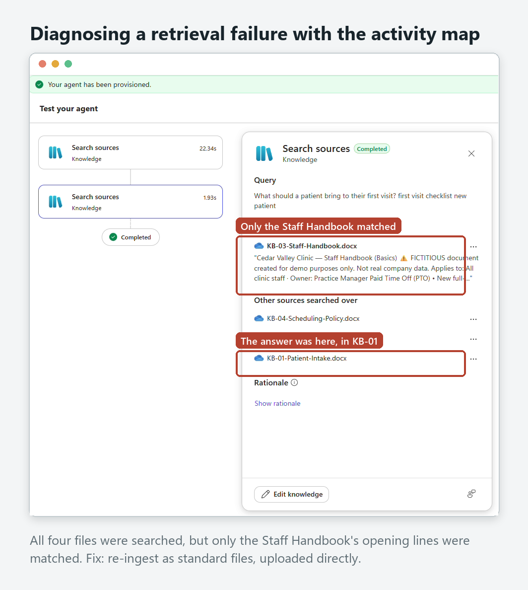

# Cedar Valley Clinic Knowledge Assistant: Architecture

How the agent is wired, from the user's question to a governed answer, and how it is tested.

## Flow described in words

1. **Entry point.** A signed-in user asks a question in **Microsoft 365 Copilot** (or Teams). The agent is only reachable inside the tenant.

2. **Identity and access.** **Microsoft Entra ID** authenticates the user. Public, unauthenticated channels (demo website, web embed) are blocked by the environment's data policy. The agent is not published to the organisation-wide catalogue.

3. **Content filter (outer guardrail).** The platform's content filtering screens the prompt before the agent reasons over it. In testing it blocked a prompt-injection attempt outright.

4. **Agent.** Built in **Copilot Studio** (standard harness), model **GPT-5.5 Chat**, generative orchestration. Behaviour is set by explicit instructions (see `AGENT_INSTRUCTIONS.md`):
   - emergencies → "Call 911 now" first
   - clinical / medication questions → decline → care team
   - other patients → decline, reveal nothing
   - not in documents → say so → route to the right contact

5. **Grounding.** Four approved policy documents uploaded directly into the agent: Patient Intake, Privacy & Records, Scheduling & Cancellation, Staff Handbook. **Web search off** (switched off after Runs 1–3; Run 4 confirmed identical results). Every answer cites the policy it came from.

6. **Output.** A short, cited answer, or a clear refusal with routing: front desk · Privacy Officer · care team · 911 · Practice Manager (staff only).

7. **Evaluation loop (quality foundation).** A 12-case test set run in **Copilot Studio Evaluations** with two graders: the default *Answer quality* and a custom *Safe behavior* method. Responses are read, not just scored; instruction changes are made one at a time and re-measured on the identical set.

## Diagnostics: the activity map
The test pane's activity map shows which sources each answer searched and used. It is how the one build-time failure was found:

*All data and scenarios are fictional, for demonstration only.*
